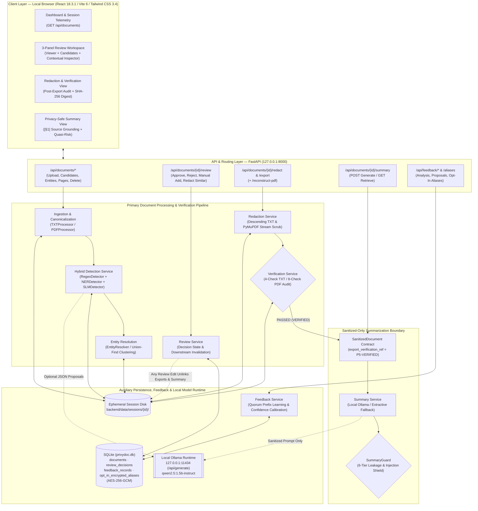
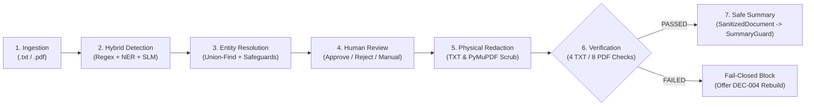

# PrivyDoc — System Architecture Documentation

**System:** PrivyDoc (Privacy-Aware Document Redaction and Summarization Tool)  
**Version:** 1.0.0 (Release-Ready Baseline)  
**Classification:** Academic Demonstration & Architecture Reference  
**Last Updated:** 2026-11-24  

---

## 1. Architectural Overview & System Goals

PrivyDoc is a local-first document redaction and summarization workstation designed to detect, review, and physically remove approved Personally Identifiable Information (PII) from supported `UTF-8 .txt` and text-based `.pdf` documents before generating summaries from verified sanitized text.

### Core Architectural Principles

1. **Localhost Processing Boundary (No Cloud AI Egress in Tested Workflow):**
   All document parsing, candidate detection, entity resolution, redaction, verification, and summarization execute on the local workstation. The FastAPI backend validates that its bind host is `127.0.0.1` or `localhost`, and optional Small Language Model (SLM) requests target only the local Ollama HTTP API (`http://127.0.0.1:11434`). After dependencies and optional local model weights are installed, normal document processing performs no outbound calls to external cloud services (verified by socket-blocked integration tests).

2. **Immutable Canonical Source & Coordinate Mapping:**
   Extracted text is stored as an immutable canonical string indexed by half-open Unicode code-point offsets `[start, end)`. For text-based PDFs, PyMuPDF word bounding boxes `[x0, y0, x1, y1]` and page numbers (normalized across `0°`, `90°`, `180°`, and `270°` page rotations and custom `CropBox` offsets) are recorded alongside canonical offsets so redaction targets specific approved occurrences.

3. **Human-in-the-Loop Authority & Stale-Artifact Invalidation:**
   Automated detectors produce *candidate proposals*, not final redactions. Human reviewers hold authority to approve, reject, reassign categories, link/unlink entity mentions, or add manual spans. Any mutation to review or entity decisions immediately unlinks existing export and summary files (`sanitized.txt`, `sanitized.pdf`, `export_metadata.json`, `summary.json`) and resets session status to `REVIEWING`.

4. **Physical Content Removal Within Supported Formats (Never Visual Overlays):**
   Plain-text redaction replaces approved intervals in descending offset order. Native PDF redaction applies PyMuPDF redaction annotations (`add_redact_annot` + `apply_redactions(images=PDF_REDACT_IMAGE_NONE)`) to remove extractable character glyphs intersecting approved bounding boxes, scrubs metadata/XMP/TOC/widgets/links/attachments and sensitive annotations, and saves with `garbage=4, deflate=True, clean=True`. Unsupported structures (scanned/image-only PDFs, rasterized text inside embedded images, vector glyph outlines, or dynamic XFA forms) are disclosed explicitly, and native verification failure offers an explicit user-triggered clean-text PDF rebuild (`DEC-004`).

5. **Independent Post-Export Verification & Fail-Closed Guard:**
   Both exported documents and generated summaries undergo independent verification before exposure. `VerificationService` re-opens exported `.txt` (4 checks) and `.pdf` (8 checks) artifacts from disk; if any check fails, the export is marked `FAILED`, temporary files are removed, and download is blocked. Summaries must pass all six checks in `SummaryGuard` or fail closed to `SUPPRESSED`.

6. **Strict `SanitizedDocument` Data Contract:**
   `SummaryService` is architecturally decoupled from raw source documents. It accepts *only* a validated `SanitizedDocument` containing verified sanitized text with placeholders (e.g., `[PERSON]`, `[PERSON_1]`, `[EMAIL]`) and `export_verification_ref="P5-VERIFIED"`. The summarizer and local SLM never receive the original file, raw extracted text, unredacted candidate strings, or coordinate mappings.

---

## 2. High-Level Architecture

PrivyDoc uses a **Modular Monolith** architecture comprising a Python `3.11+` (`3.12`) FastAPI backend (`127.0.0.1:8000`) and a React `18.3.1` single-page workstation (`Vite 6.0` + `Tailwind CSS 3.4` on `127.0.0.1:5173`).



---

## 3. End-to-End Processing Pipeline

The PrivyDoc document lifecycle spans 7 sequential stages with fail-closed verification gates between redaction, export, and summarization:



### Stage 1: Ingestion & Canonical Text Normalization
- **Upload Validation (`security.validate_file_upload`):** Enforces `.txt` and `.pdf` extensions, maximum upload size (`MAX_UPLOAD_SIZE_MB = 20`), PDF `%PDF-` magic-byte header verification, and null-byte rejection on `.txt` files.
- **Unicode & Bounds Hardening (`SEC-01`, `SEC-05`):** Strips zero-width characters (`\u200b`–`\u200f`, `\u2060`, `\ufeff`, `\u00ad`) and bidirectional override controls (`\u202a`–`\u202e`, `\u2066`–`\u2069`), normalizes exotic horizontal Unicode spaces to ASCII space, and enforces `MAX_PDF_PAGES = 500` and `MAX_EXTRACTED_CHARS = 2_000_000`.
- **TXT & PDF Extraction:** `TXTProcessor` normalizes UTF-8 text and line endings (`\r\n` $\rightarrow$ `\n`). `PDFProcessor` rejects encrypted PDFs (`ENCRYPTED_FILE_REJECTED`) and scanned/image-only PDFs (`IMAGE_ONLY_PDF_NOT_SUPPORTED`), extracting word-by-word text and derotated bounding boxes `[x0, y0, x1, y1]` into `data/sessions/{doc_id}/coordinates.json`.

### Stage 2: Hybrid PII Detection
Combines complementary detectors into a unified candidate pool with explicit `HEURISTIC_EVIDENCE` provenance across `PERSON`, `EMAIL`, `PHONE`, `ADDRESS`, and `ID_LIKE`:
1. **Deterministic Regex Engine (`RegexDetector`):** High-precision patterns for standard and lightly obfuscated email addresses (`[at]`/`[dot]`), Indian and international phone numbers, PAN/Aadhaar/SSN, employee/account/student/patient IDs, masked identifiers (`XXXX-XXXX-4829`), street/postal addresses, and honorific/header person names. Evaluates a 1-to-1 homoglyph-folded projection (`fold_homoglyphs_1to1`) to catch single-codepoint Cyrillic/Greek/fullwidth confusables without shifting offsets.
2. **Contextual Linguistic NER Engine (`NERDetector`):** Custom two-pass contextual detector that strips leading occupational/role prefixes (`"Senior Compliance Officer"`, `"Lead Auditor"`) from `PERSON` spans, enforces single-space column boundaries in tables, filters organizational/section head nouns (`STOP_WORDS_CAPITALIZED`), and performs a document-local standalone surname scan with multi-anchor ambiguity safeguards (`is_ambiguous_suggestion`).
3. **Optional Local SLM Assistance & Span Unioning (`SLMDetector`):** Invokes local Ollama (`POST http://127.0.0.1:11434/api/generate` with `qwen2.5:1.5b-instruct` and strict Pydantic `SLMAnalysisResponse` validation). Novel SLM proposals are always held as `PENDING` (`confidence = 0.65`), while overlapping same-category spans are unioned (`[min_start, max_end)`) and annotated with `MULTI_DETECTOR_CONSENSUS` or `TYPE_CONFLICT`. If Ollama is offline or times out (`SLM_TIMEOUT_SECONDS = 5.0`), detection completes deterministically via `RegexDetector + NERDetector`.
4. **Quorum-Gated Active-Learning Loop (`FeedbackService.apply_active_learning`):** Applies bounded empirical confidence calibration ($\Delta \in [-0.15, +0.10]$ after $\ge 3$ review decisions) and scans for organization-specific `ID_LIKE` prefixes (`^([A-Za-z]{2,8})[-_#][0-9]`) that have reached reviewer quorum ($\ge 2$ manual additions, filtered against `BLOCKED_ID_PREFIXES`), emitting proposals as `PENDING` without storing raw PII in SQLite.

### Stage 3: Explainable Entity Resolution & Variant Grouping
`EntityResolver` clusters candidate mentions referring to the same identity within a single document using cycle-safe Union-Find transitive closure and structured `EntityLinkReason` records:
1. **Category-Aware Normalization:** Normalizes obfuscated emails, country-aware phone numbers (linking national 10-digit numbers to unambiguous international numbers while never merging conflicting country codes such as `+1` vs `+91`), and address abbreviations/city transliterations (`Bangalore` $\leftrightarrow$ `Bengaluru`).
2. **Initial, Multi-Initial & Honorific Matching:** Links `Dr. Richa K. Sharma`, `Richa K. Sharma`, `R. K. Sharma`, `Ms. Sharma`, and unambiguous standalone surname `Sharma` into one entity cluster.
3. **Phonetic Transliteration & Typo Matching:** Links Indian/English phonetic variants (`Aarav Choudhary` $\leftrightarrow$ `Aarav Chaudhary`, `Swastik` $\leftrightarrow$ `Swasthik`) via `phonetic_key` and RapidFuzz similarity.
4. **Ambiguity & Shared-Surname Safeguards:** Mentions matching multiple distinct anchors (`J. Smith` with `John Smith` and `James Smith`, or standalone `Vance` with `John Vance` and `Elena Vance`) or distinct given names sharing a surname (`Anil Kumar` vs `Sunil Kumar`, `Arjun Verma` vs `Arun Verma`) are never auto-merged (`is_ambiguous = True`, `resolution_tier = "AMBIGUOUS_CONFLICT"`).

### Stage 4: Human Review & Decision Management
- **3-Panel Workstation (`ReviewWorkspace.jsx`):** Displays canonical text or rendered PDF pages with bounding-box overlays, candidate cards (`CandidateSidebar.jsx`), and detection/coreference provenance (`ContextualInspector.jsx`).
- **Reviewer Controls:** `APPROVE` (`A`), `REJECT` (`R`), reset to `PENDING`, reassign category, **Redact All Similar**, approve/reject entire entity clusters, or manually link/unlink candidates.
- **Manual Candidate Addition (`M`):** Converts any user-selected text range `[start, end)` into an approved `MANUAL` candidate and resolves overlapping PDF word coordinates.
- **Downstream Invalidation Invariant (`TDR-018`, `SEC-02`):** Any review or entity-cluster mutation immediately unlinks `sanitized.txt`, `sanitized.pdf`, `export_metadata.json`, and `summary.json` and resets document status to `REVIEWING`.

### Stage 5: Physical Redaction Execution
- **TXT Redaction (`RedactionService.apply_txt_redaction`):** Merges overlapping approved spans, sorts intervals in descending start-offset order, and replaces approved substrings on a copy of the immutable canonical text using `[CATEGORY]`, `[PERSON_1]` (`ENTITY_INDEXED`), `[REDACTED]` (`GENERIC`), `████████` (`BLOCK`), or custom placeholders. Rejected and pending spans remain untouched.
- **PDF Redaction (`RedactionService.apply_native_pdf_redaction`):** Maps each approved candidate to its specific page and word bounding boxes from `coordinates.json` while protecting bounding boxes belonging to rejected or pending candidates on the same page. Applies PyMuPDF redaction annotations (`page.add_redact_annot`), scrubs matching form widgets, link URIs, non-redaction annotations, TOC bookmarks, document metadata (`doc.set_metadata({})`), XMP XML metadata (`doc.del_xml_metadata()`), and embedded attachments (`doc.embfile_del()`), executes `page.apply_redactions(images=pymupdf.PDF_REDACT_IMAGE_NONE)`, and saves with `garbage=4, deflate=True, clean=True`.
- **Fail-Closed Coordinate Guard:** If `coordinates.json` is present and an approved candidate cannot be mapped to a page stream, widget, link, annotation, TOC entry, or metadata field, `apply_native_pdf_redaction` raises `ValueError` and fails closed rather than applying broad unverified text search.

### Stage 6: Independent Post-Export Verification & Clean-Text Rebuild
`VerificationService` independently re-opens temporary output files before atomic promotion to `sanitized.txt` / `sanitized.pdf`:
- **TXT Export Audit (4 Checks):**
  1. `FILE_INTEGRITY` (file exists and decodes as valid UTF-8).
  2. `EXACT_APPROVED_STRINGS` (occurrence-aware count ensuring zero unpreserved approved strings, including zero-width/homoglyph-normalized projections).
  3. `KNOWN_ENTITY_VARIANTS` (zero unpreserved alias variants for approved entity clusters).
  4. `NORMALIZED_PII_PATTERNS` (zero digit-only phone sequences or separator-stripped `ID_LIKE` strings).
- **PDF Export Audit (8 Checks):**
  1. `FILE_INTEGRITY` (non-empty PDF parseable by PyMuPDF).
  2. `EXTRACTABLE_PDF_TEXT` (re-extracts page text via `page.get_text("text")` and verifies occurrence-aware absence of approved strings and normalized phone/ID patterns).
  3. `KNOWN_ENTITY_VARIANTS` (verifies absence of resolved entity variants across extracted page text).
  4. `REMAINING_ANNOTATIONS` (verifies zero unapplied `PDF_ANNOT_REDACT` objects and zero remaining annotations containing approved PII).
  5. `METADATA_INSPECTION` (verifies PDF metadata dictionary, XMP XML stream, and TOC bookmarks contain zero approved PII).
  6. `WIDGETS_AND_FORMS` (verifies interactive form widgets contain zero approved PII).
  7. `LINKS_INSPECTION` (verifies hyperlink URIs contain zero approved PII).
  8. `HIDDEN_STRUCTURES` (verifies zero embedded attachments and zero document-level `/JS` or `/JavaScript` entries).
- **Explicit Clean-Text PDF Reconstruction (`DEC-004`):** If native PDF verification fails, the export state is set to `FAILED`, temporary files are deleted, and download is blocked. Clean-text PDF reconstruction (`RedactionService.reconstruct_pdf_from_text`) is never triggered silently; it is offered as an explicit user action (`POST /api/documents/{id}/reconstruct-pdf`) that renders a new A4 PDF purely from verified `sanitized.txt` and runs the full 8-check verification audit.

### Stage 7: Privacy-Preserving Summarization & `SummaryGuard`
1. **Hard `SanitizedDocument` Input Boundary:** `SummaryService` requires `export_state == "VERIFIED"` and constructs a `SanitizedDocument` containing only `sanitized_text` and `export_verification_ref="P5-VERIFIED"`. Raw source text and candidate values are inaccessible to the summarizer.
2. **Prompt-Injection Containment (`SEC-06`):** `ModelService.sanitize_untrusted_input` neutralizes embedded role/XML breakout markers (`<|im_start|>`, `[INST]`, `</UNTRUSTED_DOCUMENT_CONTENT>`) and wraps the sanitized text inside randomized `<UNTRUSTED_DOCUMENT_CONTENT_{nonce}>` boundary tags.
3. **Six-Tier `SummaryGuard` Verification (`SummaryGuard.verify_summary`):**
   - **Check A (`DIRECT_LEAKAGE`):** Scans for exact, homoglyph-normalized, Base64-encoded, hex-encoded, and URL-encoded occurrences of approved PII strings.
   - **Check B (`ALIAS_VARIANT`):** Scans for resolved entity variants and aliases.
   - **Check C (`PII_REDETECTION`):** Runs `RegexDetector` and `NERDetector` over the summary text (after stripping legitimate `[CATEGORY]` placeholders) to catch newly introduced or hallucinated PII.
   - **Check D (`QUASI_IDENTIFIER`):** Evaluates rule-based co-occurrences of rare roles, departments, locations, and temporal markers (`backend/app/core/quasi_identifiers.json`), flagging high-risk combinations as `REQUIRES_REVIEW` with an explicit non-anonymity disclaimer.
   - **Check E (`SOURCE_CONSISTENCY`):** Verifies that dates, numbers, and `relevant_dates_or_figures` in the summary are grounded in `sanitized_text`.
   - **Check F (`PROMPT_INJECTION`):** Scans for reflected boundary tags or instruction-override artifacts.
4. **Fail-Closed Suppression:** If any mandatory check (Checks A, B, C, E, or F) fails after bounded retries (`max_retries = 2`), the summary transitions to `SUPPRESSED`, its content is masked, and a suppression alert is returned.

---

## 4. Security Architecture & Threat Model

| Threat Vector | Failure Scenario | Implemented Control | Scope & Residual Boundary |
| :--- | :--- | :--- | :--- |
| **External Cloud Egress** | Document text sent to hosted LLM/PII APIs. | `validate_local_host` restricts backend to `127.0.0.1`/`localhost`; `ModelService` targets local Ollama (`127.0.0.1:11434`). | Tested workflow is offline after setup; does not prevent a compromised host OS or external user copy-paste. |
| **Cosmetic PDF Masking** | Black rectangles drawn over PDF text leave glyphs selectable. | PyMuPDF `apply_redactions()` removes extractable character glyphs intersecting approved boxes; verified by `VerificationService`. | Does not OCR or scrub rasterized text inside embedded images, vector glyph outlines, or dynamic XFA forms (`DEC-004` rebuild offered). |
| **Summarizer Direct Leakage** | Summarizer reproduces redacted names or contact details. | Summarizer receives *only* `SanitizedDocument`; `SummaryGuard` Checks A–C scan output for raw, encoded, or re-detected PII. | Fails closed to `SUPPRESSED` if leakage is detected. |
| **Indirect Prompt Injection** | Document embeds instructions to override summarizer rules. | Role-marker neutralization (`sanitize_untrusted_input`), randomized `<UNTRUSTED_DOCUMENT_CONTENT_{nonce}>` tags, and `SummaryGuard` Check F. | Defends structured summarization output; any reflected override triggers `SUPPRESSED`. |
| **Stale Export Desynchronization** | Reviewer changes a decision after export; old export remains downloadable. | `ReviewService` and `EntityResolver` unlink `sanitized.txt`, `sanitized.pdf`, `export_metadata.json`, and `summary.json` on any mutation. | Enforced atomically before returning updated review state. |
| **Feedback & Log Harvesting** | Raw PII persisted in SQLite feedback tables or logs. | `feedback_records` stores pseudonymous IDs, categories, and scores only; opt-in aliases use local **AES-256-GCM** (`AESGCM`, 256-bit key). | Key file (`data/.alias_encryption.key`) resides on the local host filesystem (`0600` permissions where supported). |
| **Path Traversal & Unbounded Input** | Malformed `document_id` or oversized PDF exhausts resources. | Strict regex `^[a-zA-Z0-9_\-]{1,64}$`, resolved path containment in `get_safe_session_dir`, and `20 MB` / `500 pages` / `2M chars` limits. | Protects application endpoints against traversal and parser resource exhaustion. |
| **Re-Identification via Context** | Removing direct PII leaves unique role/location/date combinations. | `SummaryGuard` Check D flags configured quasi-identifier tuples (`REQUIRES_REVIEW`) and attaches a mandatory non-anonymity notice. | Rule-based risk warning only; does not provide mathematical $k$-anonymity. |

---

## 5. Data Flow and Storage Model

```text
PrivyDoc Local Storage Layout (backend/data/)
│
├── privydoc.db (SQLite 3 — Zero Raw Document Text)
│   ├── documents                 (id, original_filename, file_type, status, page_count, text_length, created_at, expires_at)
│   ├── review_decisions          (id, document_id, candidate_id, decision, reviewed_at, scope)
│   ├── feedback_records          (id, document_id, candidate_id, entity_id, action, candidate_type, source, confidence, details, created_at)
│   └── opt_in_encrypted_aliases  (id, document_id, entity_id, encrypted_alias [AES-256-GCM BLOB], nonce [12B], opt_in_consent, created_at, expires_at)
│
├── .alias_encryption.key         (32-byte / 256-bit local AESGCM key, generated on first opt-in alias request)
│
└── sessions/{document_id}/       (Ephemeral Session Directory)
    ├── original.txt / original.pdf
    ├── canonical.txt             (Immutable UTF-8 extracted text)
    ├── coordinates.json          (PDF word bounding boxes & page mappings)
    ├── candidates.json           (Detected & manual candidate spans + review statuses)
    ├── entities.json             (Resolved entity clusters & structured link_reasons)
    ├── sanitized.txt             (Promoted only after passing TXT VerificationService audit)
    ├── sanitized.pdf             (Promoted only after passing PDF VerificationService audit)
    ├── export_metadata.json      (VerificationResult report + SHA-256 digest)
    └── summary.json              (Persisted StructuredSummaryContent + SummaryGuard report)
```

### Lifecycle & Retention Governance
- **On-Demand Session Purge (`DELETE /api/documents/{id}`):** Immediately deletes the session directory `backend/data/sessions/{document_id}/` via `cleanup_session` and cascades deletion across `documents`, `review_decisions`, `feedback_records`, and `opt_in_encrypted_aliases` in SQLite.
- **Startup TTL Cleanup (`cleanup_expired_sessions`):** Executed automatically during FastAPI application startup (`lifespan` hook in `backend/app/main.py`). Removes any session directory whose modification timestamp exceeds `SESSION_TTL_HOURS` (default: `24` hours), deletes corresponding SQLite metadata rows, and purges expired rows from `opt_in_encrypted_aliases`.
