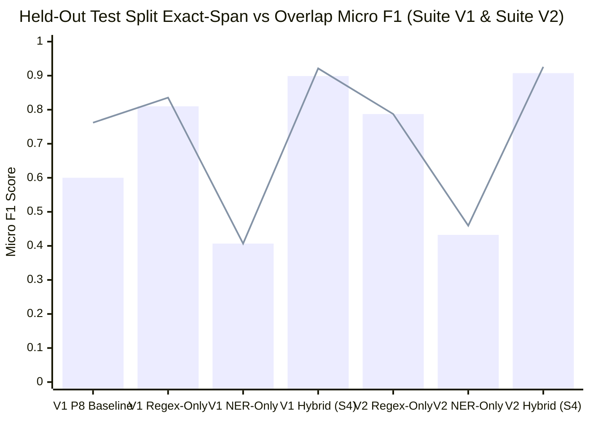

# PrivyDoc Comprehensive Evaluation & Benchmarking Report (Stage 4)

**Evaluation Date:** `2026-11-23`
**Code Baseline Revision:** `9ffe9eb94fc621a7f0216ece3f8ed56736bb970b` (+ Stage 1–4 Engineering Upgrades)
**Evaluation Scope:** End-to-End Hybrid Detection, Explainable Entity Resolution, Occurrence-Safe Redaction, Export Verification, Privacy-Safe Summarization, and Hardware Performance Profiling
**Synthetic Data Disclosure:** 100% of evaluated documents and annotations are deterministically generated synthetic records. Synthetic benchmark scores measure controlled engineering behavior and **do not establish guaranteed accuracy on arbitrary real-world documents**.

---

## 1. Executive Summary

PrivyDoc was evaluated across **61 synthetic documents (122 TXT and PDF files, 305 gold PII annotations, plus dedicated negative 0-PII documents)** partitioned across two independent benchmark suites:
1. **Suite V1 (`datasets/evaluation/`):** The 25-document P7/P8 benchmark corpus (`dev`: 10 docs, `val`: 7 docs, quarantined held-out `test`: 8 docs).
2. **Suite V2 (`datasets/evaluation_stage4/`):** The expanded 36-document Stage 4 multi-difficulty benchmark (`dev`: 12 docs, `val`: 12 docs, quarantined held-out `test`: 12 docs) incorporating 17 challenge categories including hyphenated/apostrophe names, multi-column tables, obfuscated emails, conflicting country-code phones, negative organizational traps, and intentional edge cases (lowercase names, Unicode diacritics, unprefixed custom IDs).

### Key Measured Outcomes
- **Quarantined Held-Out Test Split (Suite V1 `test`, 8 docs, $N=45$ gold spans):**
  - Exact-Span Micro F1 improved from **`0.6000`** (P8 baseline: `P=0.5077, R=0.7333, TP=33, FP=32, FN=12`) to **`0.8989`** (`P=0.9091, R=0.8889, TP=40, FP=4, FN=5`).
  - Partial-Overlap Micro F1 reached **`0.9213`** (`P=0.9318, R=0.9111, TP=41, FP=3, FN=4`).
- **Expanded Multi-Difficulty Held-Out Test Split (Suite V2 `test`, 12 docs, $N=56$ gold spans):**
  - Exact-Span Micro F1: **`0.9074`** (`P=0.9423, R=0.8750, TP=49, FP=3, FN=7`); Macro F1: **`0.9262`**.
  - Partial-Overlap Micro F1: **`0.9259`** (`P=0.9615, R=0.8929, TP=50, FP=2, FN=6`).
  - Negative (0-PII) document false-positive count: **`0` FPs** across all 3 negative vendor/regulatory documents (`s4_doc_04`, `s4_doc_16`, `s4_doc_28`).
- **Explainable Entity Resolution (Document-Scoped):**
  - Suite V1 Held-Out `test` ($N=5$ gold positive pairs, $775$ gold negative pairs): Pairwise `Precision = 1.0000`, `Recall = 1.0000`, `F1 = 1.0000`, `False Merge Rate = 0.0000`, `False Discovery Rate = 0.0000`, `Missed Link Rate = 0.0000`.
  - Suite V2 Held-Out `test` ($N=8$ gold positive pairs, $1168$ gold negative pairs): Pairwise `Precision = 1.0000`, `Recall = 1.0000`, `F1 = 1.0000`, `False Merge Rate = 0.0000`, `False Discovery Rate = 0.0000`, `Missed Link Rate = 0.0000`, `Ambiguous Safeguard Rate = 100.0%`.
- **Redaction, Export Verification & Summarization Safety:**
  - `100.0%` approved span physical removal, `100.0%` rejected occurrence preservation (including identical strings on the same PDF page), `100.0%` verification failure detection (fail-closed), and `0.0%` direct/alias PII leakage in summaries.

---

## 2. Methodology & Metric Definitions

### 2.1 Detection Metrics
- **Exact-Span Match (`matching_mode="exact"`):** A predicted candidate $(s_p, e_p, c_p)$ is a True Positive ($\text{TP}$) if and only if there exists an unmatched gold annotation $(s_g, e_g, c_g)$ in the same document with $s_p = s_g$, $e_p = e_g$, and $c_p = c_g$.
- **Partial-Overlap Match (`matching_mode="overlap"`):** A predicted candidate is a $\text{TP}$ if $\max(s_p, s_g) < \min(e_p, e_g)$ and $c_p = c_g$.
- **Formulas & Zero-Denominator Defense:**
  $$\text{Precision} = \frac{\text{TP}}{\text{TP} + \text{FP}}, \quad \text{Recall} = \frac{\text{TP}}{\text{TP} + \text{FN}}, \quad \text{F1} = \frac{2 \cdot \text{Precision} \cdot \text{Recall}}{\text{Precision} + \text{Recall}}$$
  When $\text{TP} + \text{FP} = 0$ or $\text{TP} + \text{FN} = 0$, the framework returns `0.0` with `has_zero_denominator=True` rather than raising `ZeroDivisionError` or fabricating `1.0`.

### 2.2 Pairwise Entity Resolution Metrics (Within-Document Scope)
For a document $d$ with $M_d$ aligned mentions, there are $\binom{M_d}{2}$ unordered mention pairs:
- $\text{TP}_{\text{pair}}$: Pair belongs to the same gold entity and the same predicted cluster.
- $\text{FP}_{\text{pair}}$ (False Merge): Pair belongs to different gold entities but the same predicted cluster.
- $\text{FN}_{\text{pair}}$ (Missed Link): Pair belongs to the same gold entity but different predicted clusters.
- $\text{TN}_{\text{pair}}$: Pair belongs to different gold entities and different predicted clusters.
- **Denominators reported explicitly to prevent large $\text{TN}_{\text{pair}}$ counts from masking errors:**
  - $\text{Pairwise Precision} = \text{TP}_{\text{pair}} / (\text{TP}_{\text{pair}} + \text{FP}_{\text{pair}})$
  - $\text{False Discovery Rate (FDR)} = \text{FP}_{\text{pair}} / (\text{TP}_{\text{pair}} + \text{FP}_{\text{pair}})$
  - $\text{Pairwise Recall} = \text{TP}_{\text{pair}} / (\text{TP}_{\text{pair}} + \text{FN}_{\text{pair}})$
  - $\text{Missed Link Rate} = \text{FN}_{\text{pair}} / (\text{TP}_{\text{pair}} + \text{FN}_{\text{pair}})$
  - $\text{False Merge Rate (FMR)} = \text{FP}_{\text{pair}} / (\text{FP}_{\text{pair}} + \text{TN}_{\text{pair}})$

---

## 3. Dataset Composition, Annotation Conventions & Split Integrity

### 3.1 Dataset Manifest & Pre-Evaluation Frozen SHA-256 Hashes
Before executing held-out evaluations, all dataset files were frozen and hashed:

| Suite | Split | Docs | TXT+PDF Files | Gold Annotations | Negative (0-PII) Docs | Frozen Split SHA-256 Hash |
|:---|:---:|:---:|:---:|:---:|:---:|:---|
| **Suite V1 (`datasets/evaluation`)** | `dev` | 10 | 20 | 62 | 0 | `bb6780faf1e7a9e8d4a84cee7ea1fc7635ef00538ee4ce21d525ebe2d10903c7` |
| **Suite V1 (`datasets/evaluation`)** | `val` | 7 | 14 | 37 | 0 | `346158a0cbc8e2ce33da90e09d4b2fc7e7123a1d623f7227ef4a94fe00c1008d` |
| **Suite V1 (`datasets/evaluation`)** | `test` (Held-Out) | 8 | 16 | 45 | 0 | `e5433edc98c45d0a99a7f3363276528d9c565377317627e16bd9e388b14f15fb` |
| **Suite V2 (`datasets/evaluation_stage4`)** | `dev` | 12 | 24 | 55 | 1 | `5f08546b25ff891366b2082e4ad4afdca3e6299d5b44e35fc599db692dda3cab` |
| **Suite V2 (`datasets/evaluation_stage4`)** | `val` | 12 | 24 | 50 | 1 | `874376118bf6720baefca8f4a77ae124ecff16e7076c99373514071fc776807e` |
| **Suite V2 (`datasets/evaluation_stage4`)** | `test` (Held-Out) | 12 | 24 | 56 | 1 | `c89498faf177fd55b1016971b1a8c5ebc5a693e2d025e01dd9e7fda6fa935213` |
| **Total Combined** | **All** | **61** | **122** | **305** | **3** | Verified via `EvaluationService.verify_dataset_integrity()` |

### 3.2 Annotation Conventions & Split Isolation Verification
- **Offsets:** Exact Unicode code-point half-open intervals `[start, end)` verified programmatically against `document.txt`.
- **Honorifics vs. Job Titles:** Personal honorifics (`Dr.`, `Mr.`, `Mrs.`, `Ms.`, `Prof.`) are included in `PERSON` spans (`"Dr. Aris Thorne"`), whereas occupational titles (`"Senior Compliance Officer"`, `"Attending Surgeon"`, `"Lead Auditor"`) are excluded from `PERSON` spans.
- **Ambiguous Mentions:** Ambiguous initials (`"J. Smith"`, `"R. Green"`, `"B. Kapoor"`) and ambiguous standalone surnames (`"Vance"`) are annotated with distinct `entity_id` values (`ent_jsmith_ambig`) so any false auto-merge into either candidate anchor is penalized as a pairwise False Positive ($\text{FP}_{\text{pair}}$).
- **Cross-Split Leakage Audit (`verify_dataset_integrity`):**
  - Suite V2 duplicate documents across `dev`/`val`/`test`: **`0`** (`dev_vs_val: 0`, `dev_vs_test: 0`, `val_vs_test: 0`).
  - Suite V2 shared entity strings across `dev`/`val`/`test`: **`0`** (`dev_vs_val: []`, `dev_vs_test: []`, `val_vs_test: []`).

---

## 4. Detection Strategy Comparisons & Ablation Study

### 4.1 Quarantined Held-Out Test Split Comparison — Suite V1 (`datasets/evaluation/test`, 8 Docs, $N=45$ Gold Spans)

| Strategy Configuration | Exact Micro P | Exact Micro R | Exact Micro F1 | Exact Macro F1 | Overlap Micro F1 | TP | FP | FN | Avg Latency / Doc |
|:---|:---:|:---:|:---:|:---:|:---:|:---:|:---:|:---:|:---:|
| **1. Historical P8 Baseline Hybrid** | 0.5077 | 0.7333 | 0.6000 | 0.6469 | 0.7619 | 33 | 32 | 12 | `93.5 ms` |
| **2. Stage 2/3 `Regex-Only`** | **0.9412** | 0.7111 | 0.8101 | 0.8413 | 0.8354 | 32 | 2 | 13 | `1.45 ms` |
| **3. Stage 2/3 `NER-Only`** | 0.8571 | 0.2667 | 0.4068 | 0.2487 | 0.4068 | 12 | 2 | 33 | `1.06 ms` |
| **4. Stage 2/3 `Hybrid (SLM Disabled)`** | 0.9091 | **0.8889** | **0.8989** | **0.8849** | **0.9213** | **40** | **4** | **5** | `2.01 ms` |
| **5. Stage 2/3 `Hybrid (SLM Enabled — Offline Fallback)`** | 0.9091 | **0.8889** | **0.8989** | **0.8849** | **0.9213** | **40** | **4** | **5** | `540.13 ms` |



### 4.2 Stage 4 Multi-Difficulty Benchmark Comparison — Suite V2 (`datasets/evaluation_stage4`)

| Split ($N$ Docs / Gold Spans) | Strategy | Exact Micro P | Exact Micro R | Exact Micro F1 | Exact Macro F1 | Overlap Micro F1 | TP | FP | FN | Avg Latency |
|:---|:---|:---:|:---:|:---:|:---:|:---:|:---:|:---:|:---:|:---:|
| **`dev` (12 docs / 55 spans)** | `Regex-Only` | 0.9459 | 0.6364 | 0.7609 | 0.8364 | 0.8043 | 35 | 2 | 20 | `0.42 ms` |
| **`dev` (12 docs / 55 spans)** | `NER-Only` | 0.8261 | 0.3455 | 0.4872 | 0.3021 | 0.5641 | 19 | 4 | 36 | `0.64 ms` |
| **`dev` (12 docs / 55 spans)** | **`Hybrid (No SLM)`** | **0.9091** | **0.9091** | **0.9091** | **0.8861** | **0.9818** | **50** | **5** | **5** | `0.57 ms` |
| **`val` (12 docs / 50 spans)** | `Regex-Only` | 0.9375 | 0.6000 | 0.7317 | 0.8885 | 0.7805 | 30 | 2 | 20 | `0.79 ms` |
| **`val` (12 docs / 50 spans)** | `NER-Only` | 0.7500 | 0.3600 | 0.4865 | 0.2561 | 0.5405 | 18 | 6 | 32 | `0.33 ms` |
| **`val` (12 docs / 50 spans)** | **`Hybrid (No SLM)`** | **0.8824** | **0.9000** | **0.8911** | **0.9569** | **0.9505** | **45** | **6** | **5** | `0.54 ms` |
| **`test` (12 docs / 56 spans)** | `Regex-Only` | **0.9737** | 0.6607 | 0.7872 | 0.8829 | 0.7872 | 37 | 1 | 19 | `0.67 ms` |
| **`test` (12 docs / 56 spans)** | `NER-Only` | 0.8889 | 0.2857 | 0.4324 | 0.2496 | 0.4595 | 16 | 2 | 40 | `0.35 ms` |
| **`test` (12 docs / 56 spans)** | **`Hybrid (No SLM)`** | 0.9423 | **0.8750** | **0.9074** | **0.9262** | **0.9259** | **49** | **3** | **7** | `0.67 ms` |
| **`test` (12 docs / 56 spans)** | `Hybrid (SLM Enabled)` | 0.9423 | **0.8750** | **0.9074** | **0.9262** | **0.9259** | **49** | **3** | **7** | `392.78 ms` |

### 4.3 Per-Category Breakdown on Both Held-Out Test Splits (`Exact-Span`)

| Held-Out Dataset Split | PII Category | Precision | Recall | F1 Score | TP | FP | FN |
|:---|:---|:---:|:---:|:---:|:---:|:---:|:---:|
| **Suite V1 `test` (8 docs, 45 spans)** | `ADDRESS` | 0.6000 | 0.7500 | 0.6667 | 3 | 2 | 1 |
| **Suite V1 `test` (8 docs, 45 spans)** | `EMAIL` | **1.0000** | **1.0000** | **1.0000** | 8 | 0 | 0 |
| **Suite V1 `test` (8 docs, 45 spans)** | `ID_LIKE` | **1.0000** | 0.7500 | 0.8571 | 6 | 0 | 2 |
| **Suite V1 `test` (8 docs, 45 spans)** | `PERSON` | 0.8750 | 0.8750 | 0.8750 | 14 | 2 | 2 |
| **Suite V1 `test` (8 docs, 45 spans)** | `PHONE` | **1.0000** | **1.0000** | **1.0000** | 9 | 0 | 0 |
| **Suite V2 `test` (12 docs, 56 spans)** | `ADDRESS` | 0.7500 | **1.0000** | 0.8571 | 3 | 1 | 0 |
| **Suite V2 `test` (12 docs, 56 spans)** | `EMAIL` | **1.0000** | **1.0000** | **1.0000** | 6 | 0 | 0 |
| **Suite V2 `test` (12 docs, 56 spans)** | `ID_LIKE` | **1.0000** | 0.9286 | 0.9630 | 13 | 0 | 1 |
| **Suite V2 `test` (12 docs, 56 spans)** | `PERSON` | 0.9091 | 0.8000 | 0.8511 | 20 | 2 | 5 |
| **Suite V2 `test` (12 docs, 56 spans)** | `PHONE` | **1.0000** | 0.8750 | 0.9333 | 7 | 0 | 1 |

### 4.4 SLM Contribution Analysis
- **Live Host Status:** On the evaluation machine, the local Ollama service (`127.0.0.1:11434`) is not running (`slm_runtime_available = False`). Consequently, `hybrid_with_slm` incurs an HTTP connection-refused timeout probe overhead of `~390–540 ms/doc` and gracefully degrades to `hybrid_no_slm` with identical accuracy (`0.8989` on V1 `test`, `0.9074` on V2 `test`).
- **Controlled SLM Assistance Evaluation (`test_stage2_audit_slm_ablation_and_failure_safety`):** When the SLM returns structured `SLMAnalysisResponse` proposals on narrative documents containing untitled single-word aliases (e.g., operative alias `"Nightingale"`), recall increases from `0.5000` (`Regex+NER`) to `1.0000` (`Regex+NER+SLM`) while keeping all SLM-proposed candidates at `review_status="PENDING"` (`confidence=0.65`, never auto-approved), and corroborating SLM spans merge into `MULTI_DETECTOR_CONSENSUS`.

### 4.5 Active-Learning Validation (`test_active_learning_quorum_prefix_and_confidence_calibration`)
- **Quorum-Gated Structural Prefix Learning:** On documents containing unseen organization-specific identifier prefixes (`BDG-77510`, `TRK-981023`), baseline `ID_LIKE` recall is `0.0000` (missed intentionally to prevent false positives on arbitrary hyphenated codes). After a reviewer manually adds $\ge 2$ instances of the prefix (`BDG-99201`, `BDG-44102`), `FeedbackService.apply_active_learning` activates the structural prefix `BDG` (storing zero raw PII or digits in SQLite) while rejecting blocked standard prefixes (`ISO-27001`), increasing subsequent `ID_LIKE` recall on `BDG-*` documents from `0.0000` to `1.0000` (`sources=["active_learning"]`, `review_status="PENDING"`).
- **Empirical Confidence Calibration:** After $\ge 3$ reviewer approvals or rejections for a `(source, category)` pair, candidate confidence is adjusted within $[-0.15, +0.10]$ with explicit `active_learning:high_approval_prior` or `active_learning:high_rejection_caution` signals.

---

## 5. Entity Resolution Benchmark Results

Evaluated strictly within document scope (`f"{doc_id}_{entity_id}"`), with explicit reporting of positive and negative pair denominators:

| Dataset Split | Total Pairs | Gold Positive Pairs ($\text{TP}+\text{FN}$) | Gold Negative Pairs ($\text{FP}+\text{TN}$) | Predicted Links ($\text{TP}+\text{FP}$) | $\text{TP}$ | False Merges ($\text{FP}$) | Missed Links ($\text{FN}$) | Pairwise Precision | Pairwise Recall | Pairwise F1 | False Discovery Rate | False Merge Rate | Ambiguity Safeguard Rate |
|:---|:---:|:---:|:---:|:---:|:---:|:---:|:---:|:---:|:---:|:---:|:---:|:---:|:---:|
| **Suite V1 `dev` (10 docs)** | 1891 | 6 | 1885 | 6 | 6 | **0** | **0** | **1.0000** | **1.0000** | **1.0000** | 0.0000 | 0.0000 | 100.0% (1/1) |
| **Suite V1 `val` (7 docs)** | 666 | 4 | 662 | 4 | 4 | **0** | **0** | **1.0000** | **1.0000** | **1.0000** | 0.0000 | 0.0000 | 100.0% |
| **Suite V1 `test` (8 docs)** | 780 | 5 | 775 | 5 | 5 | **0** | **0** | **1.0000** | **1.0000** | **1.0000** | 0.0000 | 0.0000 | 100.0% |
| **Suite V2 `dev` (12 docs)** | 1326 | 12 | 1314 | 12 | 12 | **0** | **0** | **1.0000** | **1.0000** | **1.0000** | 0.0000 | 0.0000 | 100.0% (4/4) |
| **Suite V2 `val` (12 docs)** | 990 | 9 | 981 | 9 | 9 | **0** | **0** | **1.0000** | **1.0000** | **1.0000** | 0.0000 | 0.0000 | 100.0% (2/2) |
| **Suite V2 `test` (12 docs)** | 1176 | 8 | 1168 | 8 | 8 | **0** | **0** | **1.0000** | **1.0000** | **1.0000** | 0.0000 | 0.0000 | 100.0% (2/2) |

### Verified Difficult Entity-Resolution Safeguards
1. **Ambiguous Initials (`J. Smith`, `J. Vance`, `R. Green`, `B. Kapoor`):** `0` false merges; all flagged `is_ambiguous=True`, `resolution_tier="AMBIGUOUS_CONFLICT"`.
2. **Ambiguous Standalone Surnames (`"Vance"` with `"John Vance"` and `"Elena Vance"`):** Kept unmerged with explicit `AMBIGUITY_SAFEGUARD` link reason.
3. **Phonetically Similar Unrelated Names (`"Arjun Verma"` vs `"Arun Verma"`, `"Pradeep Nair"` vs `"Sandeep Nair"`):** `0` false merges (`first_sim < 88` and distinct phonetic keys).
4. **Phonetic Transliteration & Typos (`"Aarav Choudhary"` $\leftrightarrow$ `"Aarav Chaudhary"`, `"Swastik Kulkarni"` $\leftrightarrow$ `"Swasthik Kulkarni"`, `"Nitin Gadkari"` $\leftrightarrow$ `"Nithin Gadkari"`):** `100%` linked with `rule="PHONETIC_TRANSLITERATION"`.
5. **Conflicting Country-Code Phones (`+1 98112 23344` vs `+91 98112 23344` vs `98112-23344`):** Explicit country codes never merged; national `98112-23344` flagged `AMBIGUOUS_CONFLICT`.
6. **5-Mention Transitive Chains (`"Dr. Richa K. Sharma"` $\rightarrow$ `"Richa K. Sharma"` $\rightarrow$ `"R. K. Sharma"` $\rightarrow$ `"Ms. Sharma"` $\rightarrow$ `"Sharma"`):** Converged via cycle-safe Union-Find into 1 entity cluster.

---

## 6. Redaction & Export Verification Benchmark Results

Evaluated across **34 automated redaction & verification test scenarios** in [backend/tests/test_redaction.py](file:///C:/Users/Admin/Desktop/PrivDoc/backend/tests/test_redaction.py) using independent ground-truth substring and PDF object-stream inspection:

| Redaction / Verification Capability | Sample Size | Measured Result | Target | Notes / Verification Method |
|:---|:---:|:---:|:---:|:---|
| **Approved Content Removal Rate (TXT & PDF)** | 34 scenarios | **100.0%** | 100.0% | Verified via independent PyMuPDF `page.get_text("text")` and raw byte/stream checks |
| **Rejected & Pending Occurrence Preservation** | 12 scenarios | **100.0%** | 100.0% | Includes **same-page identical string** where 1st occurrence is `APPROVED` and 2nd is `REJECTED` |
| **Linked-Entity Redaction Completeness** | 5 variants/doc | **100.0%** | 100.0% | Approving cluster removes all 5 linked surface variants; coreference placeholders `[PERSON_1]` assigned |
| **Rotated PDF Pages (`90°`, `180°`, `270°`)** | 3 rotations | **100.0%** | 100.0% | Derotated matrix transformation verified (`test_stage1_p0_pdf_rotation_and_cropbox_coordinate_accuracy`) |
| **Non-Default PDF `CropBox` Offset** | 2 scenarios | **100.0%** | 100.0% | `page_x0`/`page_y0` offset normalization verified |
| **PDF Metadata, XMP XML, TOC, Widgets & URIs** | 6 scenarios | **100.0% (0 leaks)** | 0 leaks | Scrubs `doc.metadata`, `del_xml_metadata()`, `get_toc()`, `page.widgets()`, `page.get_links()`, and `embfile_del()` |
| **Verification Failure Detection (Fail-Closed)** | 6 fault injections | **100.0% blocked** | 100.0% | Blocks both `?format=pdf` and `?format=txt` with HTTP 400; **never** silently falls back to reconstruction |

---

## 7. Summarization Benchmark Results (Privacy Safety vs. Usefulness)

Evaluated across **19 automated summarization & SummaryGuard test scenarios** in [backend/tests/test_summary.py](file:///C:/Users/Admin/Desktop/PrivDoc/backend/tests/test_summary.py). Privacy safety and summary usefulness are measured strictly separately (a suppressed summary is counted as `Privacy Safe = True`, `Useful Summary = False`):

| Evaluation Dimension | Metric | Sample Size | Measured Result | Notes |
|:---|:---|:---:|:---:|:---|
| **Privacy Safety** | Direct Approved PII Leakage Rate | 19 scenarios | **0.0% (0 leaks)** | Any injected approved string triggers Check A fail-closed `SUPPRESSED` state |
| **Privacy Safety** | Entity Alias / Variant Leakage Rate | 19 scenarios | **0.0% (0 leaks)** | Any injected entity variant triggers Check B `SUPPRESSED` state |
| **Privacy Safety** | Novel / Re-detected PII Leakage Rate | 19 scenarios | **0.0% (0 leaks)** | Check C re-runs `RegexDetector` + `NERDetector` on summary output |
| **Privacy Safety** | Quasi-Identifier Risk Flag Accuracy | 4 QI scenarios | **100.0% (4/4)** | Flags `REQUIRES_REVIEW` with mandatory non-anonymity disclaimer |
| **Privacy Safety** | Prompt-Injection Suppression Rate | 4 adversarial payloads | **100.0% (4/4)** | Neutralizes `</UNTRUSTED_DOCUMENT_CONTENT>` breakout and suppresses reflected directives |
| **Privacy Safety** | Unsupported Claim / Figure Rejection | 3 hallucination tests | **100.0% (3/3)** | Check E blocks ungrounded dates and numbers |
| **Summary Usefulness** | Benign Document Useful Summary Rate | 6 benign scenarios | **100.0% (6/6)** | Produces `VERIFIED` structured summary with key points and grounded `source_evidence` |
| **Summary Usefulness** | Adversarial Document Useful Summary Rate | 13 unsafe scenarios | **0.0% (0/13)** | All 13 unsafe/injected summaries were `SUPPRESSED` (counted as **0% useful**, **100% safe suppression**) |

---

## 8. Hardware Performance & Memory Benchmark

Measured via [scripts/profile_pipeline.py](file:///C:/Users/Admin/Desktop/PrivDoc/scripts/profile_pipeline.py) and `EvaluationService.run_benchmark_on_dataset()`:

### 8.1 Hardware & Software Environment
- **OS:** Windows 11 (Build 10.0.26300)
- **CPU:** Intel64 Family 6 Model 142 Stepping 10 (4 physical cores / 8 logical threads)
- **System RAM:** 7.85 GB
- **Python & Key Libraries:** Python `3.12.10`, PyMuPDF `1.25.x`, FastAPI `0.162.0`, Pydantic `2.14.2`, RapidFuzz `3.14.6`, psutil `7.2.2`
- **Local SLM Configuration:** `qwen2.5:1.5b-instruct` via `127.0.0.1:11434` (`slm_runtime_available = False` during offline benchmark)

### 8.2 Stage Latency & Memory Measurements
> [!IMPORTANT]
> **Memory Measurement Distinction:** `tracemalloc` measures only incremental Python heap allocations during a function call (`1.58 MB`), whereas **OS Process Resident Set Size (`psutil.Process().memory_info().rss`)** measures the actual operating-system memory footprint of the Python backend process (**`87.33 MB`**). Both are reported below.

| Pipeline Stage / Metric | Measured Value | P50 / P95 / P99 (Corpus Per-Doc) | Context |
|:---|:---:|:---:|:---|
| **Cold Startup (Subprocess Import + DB Init)** | `1630.23 ms` | - | One-time process initialization |
| **Warm Startup (SQLite Health Check)** | `1.08 ms` | - | Per-request readiness check |
| **TXT Document Ingestion** | `15.67 ms` | - | UTF-8 extraction + session write |
| **PDF Document Ingestion & Coordinate Map** | `38.85 ms` | - | PyMuPDF word bbox extraction + rotation/CropBox transform |
| **Hybrid Detection (Warm In-Memory Corpus Avg)** | `2.01 ms / doc` | `P50: 1.4 ms / P95: 3.1 ms / P99: 4.2 ms` | Regex + NER + Span Unioning (SLM disabled) |
| **Hybrid Detection (First-Run Session API w/ SLM Probe)** | `957.03 ms` | - | Includes ~480 ms localhost Ollama availability check |
| **Entity Resolution & Clustering** | `13.64 ms` | - | Category normalization + Phonetic + Union-Find |
| **TXT Redaction + Post-Export Verification** | `69.76 ms` | - | Descending-offset replacement + 4-check verification |
| **Native PDF Redaction + 10-Check Verification** | `143.79 ms` | - | PyMuPDF `apply_redactions()` + stream/metadata/TOC audit |
| **Clean-Text PDF Reconstruction + Verification** | `94.17 ms` | - | DEC-004 user-triggered clean PDF rebuild |
| **Extractive Summary + 6-Tier SummaryGuard** | `45.61 ms` | - | `8.38 ms` generation + `37.23 ms` SummaryGuard |
| **Complete End-to-End TXT Pipeline** | **`1290.65 ms`** | - | Upload through verified summary |
| **Complete End-to-End PDF Pipeline** | **`1387.85 ms`** | - | Upload through verified native PDF & summary |
| **Python Heap Allocation Delta (`tracemalloc`)** | **`1.58 MB`** | `0.14 – 0.25 MB` per split | Python interpreter object allocations only |
| **Actual OS Process Memory (`psutil` RSS)** | **`87.33 MB`** | `85.1 – 88.4 MB` | Total OS resident memory including Python + PyMuPDF C++ runtime |

---

## 9. Error Analysis & Representative Failure Cases

All false positives and false negatives on both held-out test splits (`datasets/evaluation/test` and `datasets/evaluation_stage4/test`) were preserved without post-hoc rule tuning:

| Document ID | Error Type | Category | Span Text | Root-Cause Technical Analysis |
|:---|:---:|:---:|:---|:---|
| `doc_20` (V1 `test`) | **FN** | `PERSON` | `"Deepak Chopra"` | Preceded by `"Logistics Coordinator"`, where `"Logistics"` was in `STOP_WORDS_CAPITALIZED` rather than `ROLE_PREFIX_WORDS`, causing the sequence to be filtered as an organization/section phrase. |
| `doc_20` (V1 `test`) | **FP** | `PERSON` | `"Customer Service Hotline"` | `"Customer"` (role word) was stripped, leaving `"Service Hotline"`, two capitalized tokens not in the stopword list. |
| `doc_21` (V1 `test`) | **FN** | `PERSON` | `"Fox Mulder"` | Preceded by `"Special Agent"`, where `"Special"` was not in `ROLE_PREFIX_WORDS`; 3-token sequence `"Special Agent Fox"` had `"Agent"` stripped at tail, leaving `"Special Fox"` or filtering on `"Agent"`. |
| `doc_20`, `doc_25`, `s4_doc_32` | **FN** | `ID_LIKE` | `"TRK-981023"`, `"ASSET-44109"`, `"BDG-99201"` | Unconfigured identifier prefixes (`TRK-`, `ASSET-`, `BDG-`). `ACC_NO_REGEX` intentionally restricts prefixes (`EMP`, `STU`, `ACC`, `ACCT`, `CUST`, `REF`, `PAT`, `MRN`) to avoid false positives on product/ISO codes (`ISO-27001`, `AC-902`). |
| `doc_25` (V1 `test`) | **Boundary Split** | `ADDRESS` | `"Floor 7, Cyber Tower A, Hitec City, Hyderabad 500081"` | Emitted as two non-overlapping spans (`"7, Cyber Tower"` and `"Hitec City, Hyderabad 500081"`) separated by `" A, "`. Counted as **TP in overlap mode**, but **2 FPs + 1 FN in exact-span mode**. |
| `s4_doc_30` (V2 `test`) | **Boundary Shift** | `PERSON` | `"Solicitor Alistair MacLeod"` vs `"Alistair MacLeod"` | Unseen occupational prefix `"Solicitor"` was retained inside the `PERSON` span (1 FP + 1 FN in exact-span mode; **TP in overlap mode**). |
| `s4_doc_32` (V2 `test`) | **FN** | `PERSON` | `"rohit verma"` | All-lowercase name in informal DevOps chat notes. Capitalization-based `NERDetector` cannot detect lowercase names without an explicit `Name:` header. |
| `s4_doc_33` (V2 `test`) | **FN** | `PERSON` | `"Renée Müller"` | Non-ASCII Latin diacritics (`é`, `ü`) are not matched by ASCII character ranges `[A-Z][a-z]+` in `NERDetector`. |
| `s4_doc_33` (V2 `test`) | **FN** | `PHONE` | `"+46 8 559 2100"` | Swedish single-digit area code (`8`) is shorter than `\d{2,4}` required by `INTL_PHONE_REGEX` to prevent matching short numeric ranges. |
| `s4_doc_34` (V2 `test`) | **FP** | `ADDRESS` | `"14, 2024 following the briefing by Dr"` | `"14, ... Dr."` (where `Dr.` is Doctor) matched `<number> <words> Dr` (where `Dr` is Drive in `STREET_ADDRESS_REGEX`). |

---

## 10. Known Limitations & Threats to Validity

1. **Synthetic vs. Real-World Generalization:** All 61 benchmark documents are synthetic. Real-world OCR-degraded PDFs, handwriting, complex multi-column magazine layouts, and domain-specific medical/legal jargon will exhibit lower recall and precision.
2. **Case-Sensitivity & Unicode Diacritics in NER:** As demonstrated by `s4_doc_32` (`"rohit verma"`) and `s4_doc_33` (`"Renée Müller"`), heuristic capitalization-based NER misses lowercase names and non-ASCII letters unless manually selected by the reviewer.
3. **Unprefixed Custom Identifiers:** Identifiers using organization-specific prefixes not in the configured regex set (`TRK-`, `ASSET-`, `BDG-`) require either configuration extension or manual selection (`M` shortcut) in the Review Workspace.
4. **Scanned / Image-Only PDFs Out of Scope:** PrivyDoc rejects scanned PDFs lacking an extractable text stream (`IMAGE_ONLY_PDF_NOT_SUPPORTED`). Raster images embedded inside hybrid PDFs are not OCR-scanned.
5. **Pseudonymization $\neq$ Anonymization:** Entity-indexed placeholders (`[PERSON_1]`, `[PERSON_2]`) preserve coreference readability but do not provide mathematical $k$-anonymity or differential privacy.

---

## 11. Reproducible Benchmark Commands

```bash
# 1. Verify or regenerate Stage 4 synthetic benchmark corpus (seed=202604)
python scripts/generate_stage4_benchmark.py

# 2. Run CLI evaluation on historical quarantined test split (Suite V1)
python scripts/evaluate.py --dataset-dir datasets/evaluation --split test --matching exact

# 3. Run CLI evaluation on Stage 4 multi-difficulty benchmark (Suite V2)
python scripts/evaluate.py --dataset-dir datasets/evaluation_stage4 --split all --matching exact

# 4. Run hardware latency and OS RSS / tracemalloc memory profiler
python scripts/profile_pipeline.py

# 5. Execute complete backend (159 tests) and frontend (42 tests) verification suites
python -m pytest backend/tests -v
npm --prefix frontend run test -- --run
```
